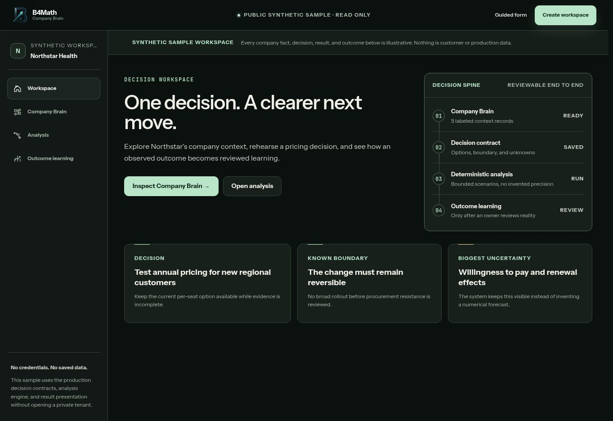
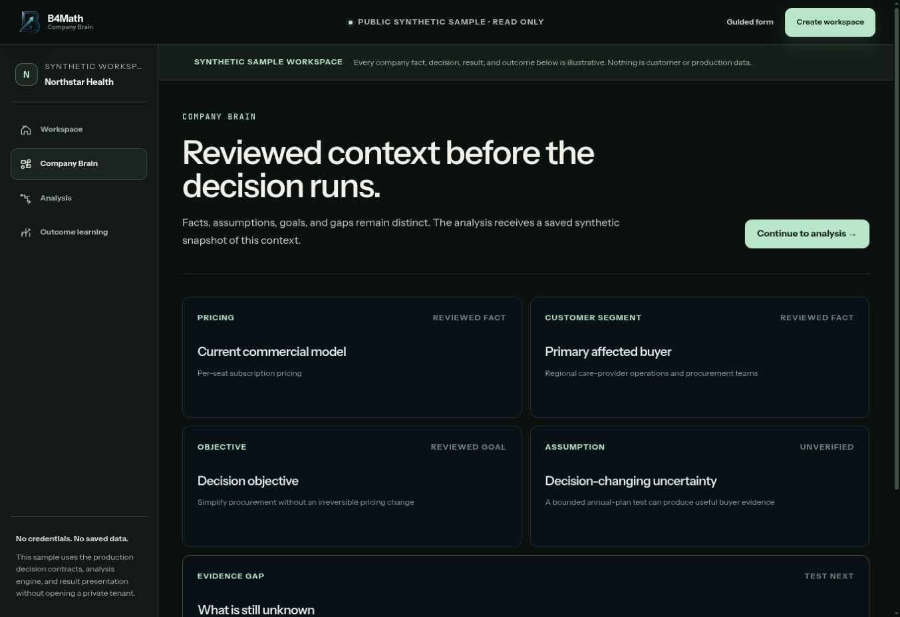
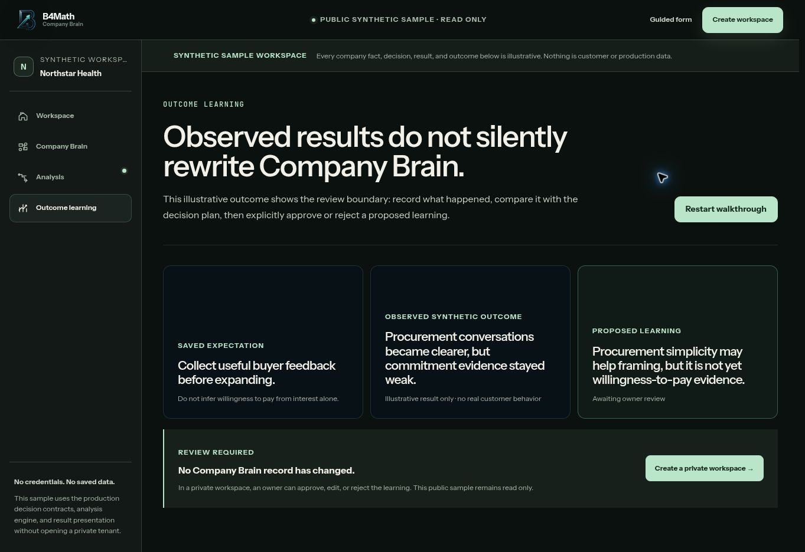
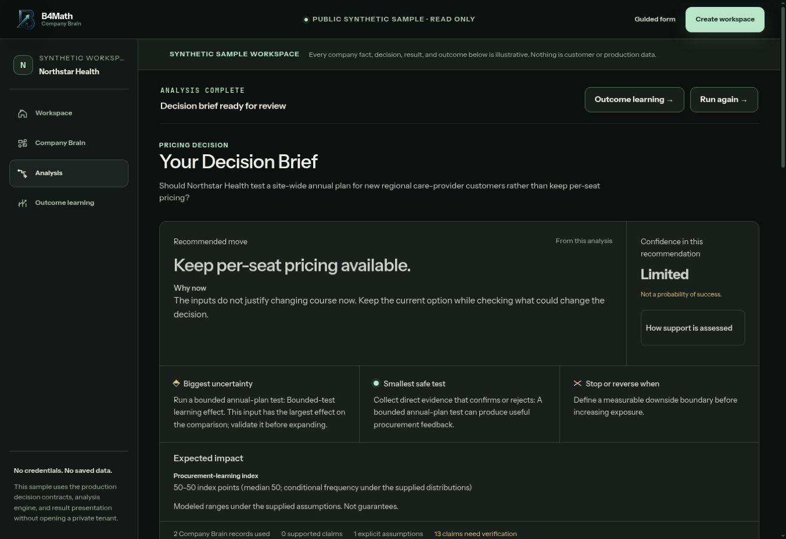

# B4Math

**Rehearse a business decision, inspect its assumptions, then compare it with what happened.**

I founded B4Math and lead its architecture, backend development and decision algorithms. The engineering problem is connecting uncertain business inputs to calculations that can be checked, saved and revisited.

**Paulius Pukinskas · Solo founder · Backend and algorithms · 2026**

[Try the working demo](https://b4math.com/demo) · [Backend case studies](docs/BACKEND_CASE_STUDIES.md) · [My contribution](docs/MY_BACKEND_AND_ALGORITHM_WORK.md) · [Selected original source](public-code/README.md)

[](https://b4math.com/demo)

*Working public demo, captured November 7, 2026. The company and its data are synthetic.*

## The backend work

| Problem | My engineering work | Concrete example |
| :--- | :--- | :--- |
| A model can suggest revenue without explaining it | A typed dependency graph derives financial outputs from explicit behavioral inputs, checking dependencies, units and scope | A synthetic source fixture derives **$12,757.50 MRR** from conversion, churn, ARPU and plan migration |
| Company knowledge changes after a decision | Versioned Company Brain records, evidence lineage and frozen decision context | An edit creates a revision; carried evidence retains its original observation date |
| A background job can be delivered twice or fail halfway through | Database backed execution, durable enqueue intent, separate attempts and controlled result commits | Duplicate delivery must produce one durable result |
| An attractive calculation can hide missing evidence | Missing primary objectives and invalid numerical inputs block unsupported ranking | An available minor metric cannot replace an unavailable primary objective |
| Observed outcomes can be interpreted incorrectly | Proposed learning requires review before changing company memory | The public outcome view shows that no Company Brain record has changed |

[Worked calculations, failure cases and original test evidence](docs/BACKEND_CASE_STUDIES.md).

I made the architecture and product decisions and worked hands on in the backend and algorithm layer. AI coding assistants supported implementation, especially frontend iteration and repetitive tasks. Runtime language models are pretrained models accessed through APIs.

## Follow a decision through the product

| Company context | Outcome review |
| :---: | :---: |
| [](docs/PRODUCT_WALKTHROUGH.md#company-brain) | [](docs/PRODUCT_WALKTHROUGH.md#outcome-learning) |
| Review the context used by the calculation. | Compare an expectation with an observed outcome. |

[](docs/PRODUCT_WALKTHROUGH.md#decision-result)

The public sample runs a prepared deterministic analysis and exposes its evidence limits, next test and stopping boundary. It preserves the current pricing option because the supplied evidence is insufficient to justify changing course.

[Six image walkthrough](docs/PRODUCT_WALKTHROUGH.md) · [Earlier development captures](docs/VERIFICATION_AND_CREDITS.md#visual-evidence)

## Verification and inspectable code

The original private application's November 1 CI record contains **981 passing unit tests, one skipped test, and 84 passing integration tests**. Its calculation graph suite has 11 passing tests; the Company Brain readiness suite has three. These are correctness and integration checks, not measured forecast accuracy.

Two small original TypeScript modules are public. They demonstrate revenue break even and economics that preserve unknown costs. Their **five public tests** run without credentials or installation on Node 22.16 or newer:

```bash
cd public-code
npm test
```

[Source provenance](public-code/README.md) · [Verification record and scope](docs/REVIEW_CHECKS.md)

## How the system developed

| Iteration | Engineering change |
| :--- | :--- |
| July | Versioned company memory and durable execution |
| August | Derived SaaS accounting graph and behavioral inputs |
| September | Explicit unknown costs and economics |
| October | Numerical safety, replay versions and missing objective safeguards |

[Build history and original commit references](docs/DEVELOPMENT_HISTORY.md) · [Architecture](assets/architecture.svg)

This showcase contains selected original source, demonstrations and documented engineering cases. The commercial codebase remains private. [Credits and evidence scope](docs/VERIFICATION_AND_CREDITS.md) distinguish source inspection, synthetic examples and real outcome validation.

