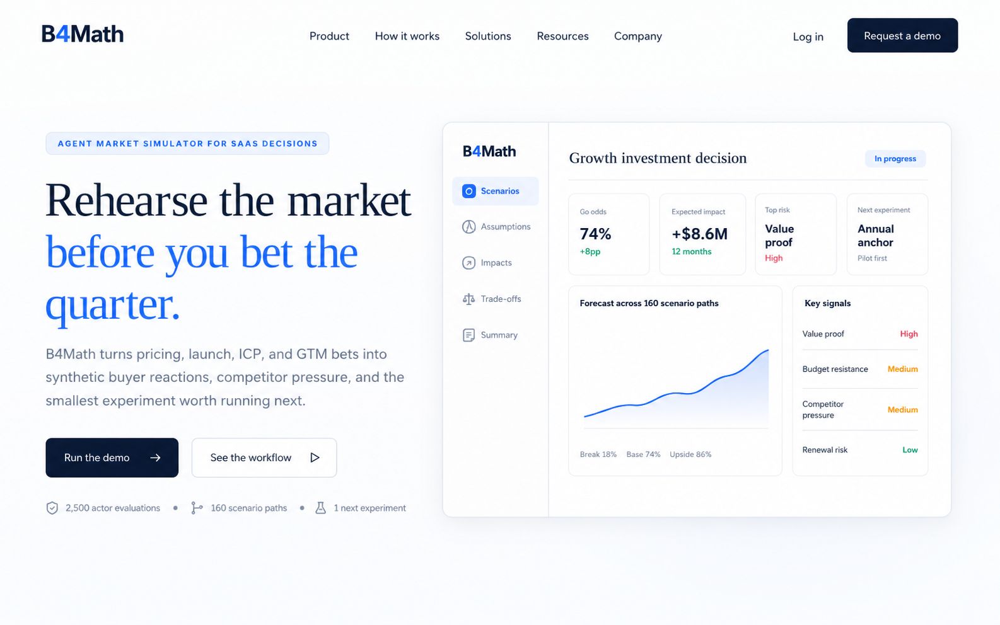
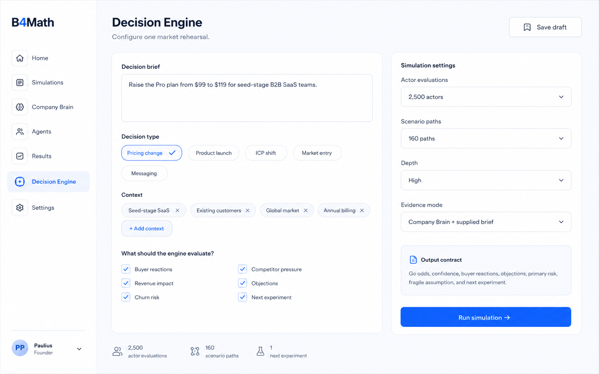
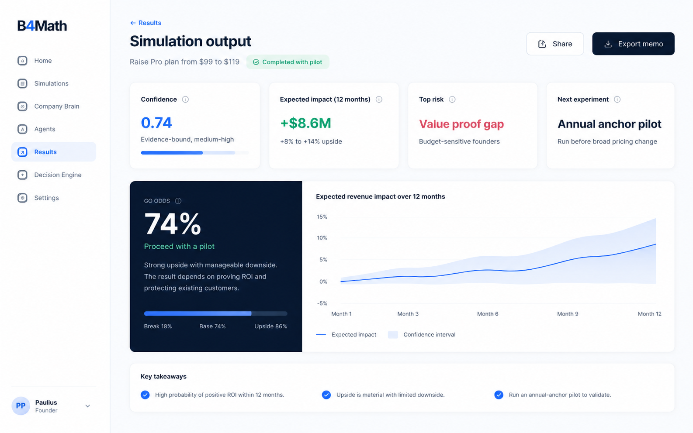
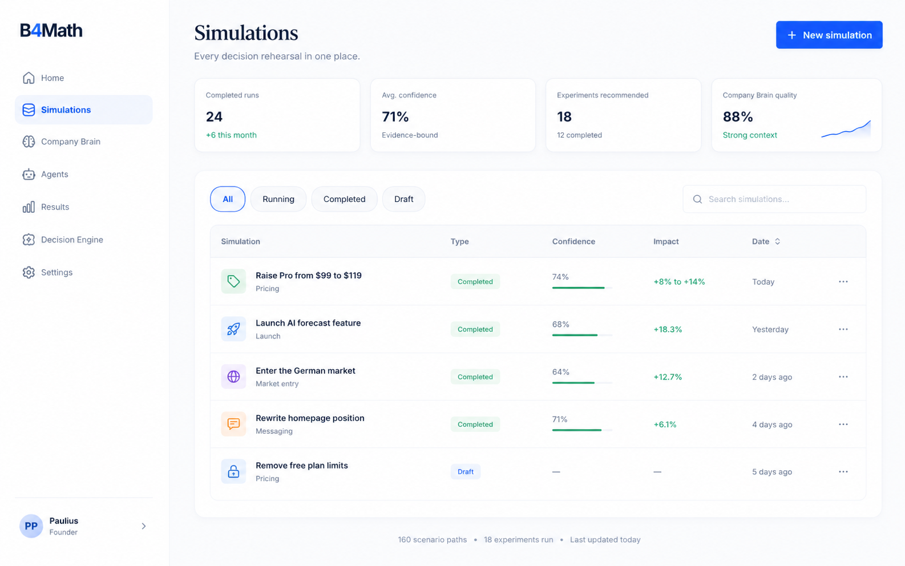
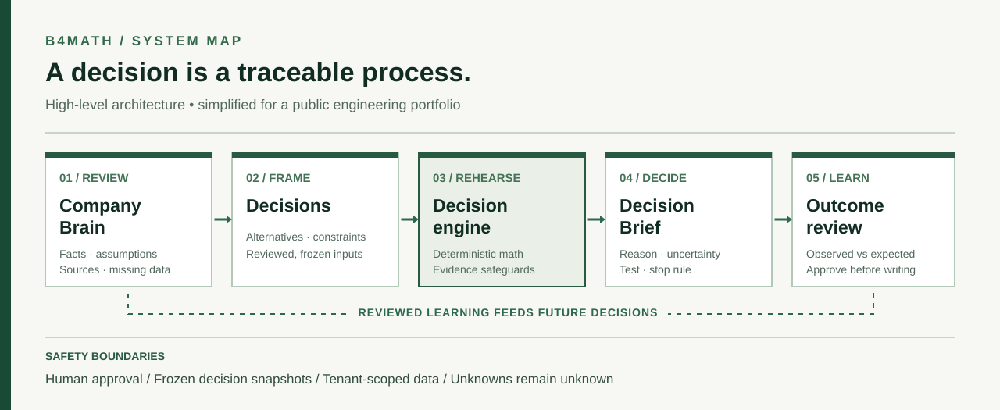

# B4Math

**Rehearsing business decisions before committing real resources.**

B4Math is a product I founded and built to explore a question: **Could software help a company test the reasoning behind an important decision, rather than merely generate a confident sounding answer?**

A company can build a reviewable picture of its business, frame an alternative, inspect assumptions and constraints, run a structured decision rehearsal, and later compare expectations with outcomes. The long term ambition is a persistent *Company Brain* that learns from decisions only after human review.

> **Maker portfolio context.** This is a public, curated engineering case study, **not the application's source repository**. Product screenshots use synthetic example data; proprietary implementation and customer information are deliberately excluded.

## At a glance

| | |
| :--- | :--- |
| **Role** | Solo founder, product architect and developer |
| **What I contributed** | Product concept, system architecture, substantial backend development, decision and simulation logic, data and evaluation workflows, integrations and engineering validation |
| **How I built it** | Independently, with AI coding assistants used for portions of implementation, particularly frontend iteration and repetitive development tasks |
| **Stack (high level)** | TypeScript, Next.js, Node.js, PostgreSQL, Redis, background workers, external language model APIs |
| **What I learned** | How to separate persuasive AI output from defensible calculation, design explicit human approval boundaries, and evolve a prototype into a durable application |

**[Explore the live synthetic sample](https://b4math.com/demo)** · [Current product site](https://b4math.com/)  
The live sample is read-only and uses fictional company context; it is separate from private customer data.

## Inspect genuine source and runnable tests

**[Open the original TypeScript source excerpts and no-dependency test suite](public-code/README.md).** These are two small, safe modules extracted from the actual private B4Math application, not freshly invented representations of its source. The extracted modules demonstrate revenue break-even safeguards and correct handling of unknown costs.

`cd public-code && npm test` runs the public checks with Node 22.16+. This is **not** the complete application codebase. The sensitive decision engine, tenant data, credentials and backend infrastructure remain private.

## Product screenshots

*Archived captures from the development process, shown with synthetic demonstration data. They document UI iterations rather than verified business outcomes.*

01 · An early public presentation. A demo was necessary so reviewers could understand the concept without connecting private company records.

| Decision setup | Decision result |
| :---: | :---: |
|  |  |
| Input choices and assumptions | A structured, inspectable example output |

04 · A decision history view. Preserving earlier decisions matters because later results should be compared against what was actually predicted at the time.

## The engineering problem

A language model can draft plausible explanations, but plausible explanations are not evidence. B4Math therefore separates the responsibilities of its major components.

1. **Company Brain:** Stores reviewable company context, sources, assumptions and missing information.
2. **Decision framing:** Turns a question into explicit alternatives, objectives, constraints and a frozen input.
3. **Rehearsal:** Combines model-assisted interpretation with deterministic calculations, evidence checks and safeguards. Missing inputs must not become invented numbers.
4. **Durable execution:** Runs work through background jobs, stores outcomes and allows history to be reopened.
5. **Learning:** Compares a saved expectation with an observed result; a human approves changes to the company model.

The design is intentionally **decision support**, not an autonomous CEO and not a claim to accurately predict markets.

## My contribution

**I was the sole founder and the person responsible for the system's technical direction.** I worked on backend architecture and implementation, decision/simulation algorithms, persistence and workflow design, model integrations, tests, and deployment. I also designed the product's behavior and reviewed how its components fit together.

I used AI assistants as development tools, including for frontend development, boilerplate and iteration. Their use does not replace my responsibilities for the underlying design, business logic, integration, debugging and verification. I do not claim to have trained the underlying language models.

The hardest choices were not cosmetic: deciding which quantities were actually computable, ensuring a failed background process would not silently lose a decision, and preventing unreviewed AI output from mutating durable business context.

## The build, not just the finished UI

| Period | Evidence of iteration |
| :--- | :--- |
| **Before July 2026** | Earlier B4Math product iteration existed before the custom stack migration. |
| **July 16, 2026** | Imported the previous production baseline and began the custom TypeScript stack. Added tenant-aware persistence, a versioned Company Brain foundation and durable simulation execution. |
| **July 23–30** | Expanded the decision engine, human review and result presentation; added authenticated workflows, an AI Operator, a synthetic public demo and outcome learning. |
| **August** | Improved robustness and reviewability, calibrated the product around a more coherent decision workflow, tested mobile layouts and refined the interface. |
| **September** | Expanded evidence-aware company workflows, explored decision categories and strengthened the reliability of the public demo and persisted workflows. |
| **October** | Focused the product around Company Brain → Decide → Rehearse → Learn; improved deterministic safeguards, mathematical correctness, uncertainty handling, first-party synthetic personas and follow-up workflows. |
| **November 1** | Added developer setup documentation and regression coverage for dependencies in derived business metrics. |

**[Read the dated development history →](docs/DEVELOPMENT_HISTORY.md)**  
**[Explore engineering decisions and tradeoffs →](docs/ENGINEERING.md)**  
**[See what the evidence does and does not prove →](docs/VERIFICATION_AND_CREDITS.md)**

## What makes this a maker project

I did not stop at a visual prototype. I had to decide where algorithmic calculation ends and uncertain human judgment begins; make state durable and permissions explicit; repair failures found in tests; and revise the interaction design after real browser inspection. Several iterations contradicted my initial assumptions, and the build history documents those changes.

This public repository intentionally contains **screenshots, diagrams, chronological notes and a contribution account only**. It does not reproduce backend source, API keys, infrastructure credentials, proprietary decision policies, private company records or operational endpoints.

---

*Built and documented by Paulius Pukinskas · 2026. This documentation is a retrospective of a longer private development history; the public repository's creation date is not the project's start date.*
