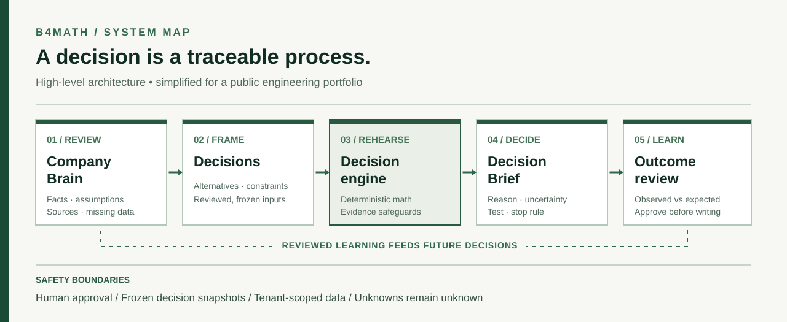

# Under the hood · Engineering choices

This page describes the **system boundaries and reasoning**, not proprietary algorithms or deployable source.

## Problem 1 · An AI response is not a trustworthy business calculation

I wanted a business owner to ask something like “Should we change our price?” and get more than a persuasive paragraph.

A defensible answer requires an explicit baseline, alternatives, constraints, known facts, assumptions and an explanation of what cannot be inferred. A model can help propose decision structure and summarize supporting material, but an unchecked model output cannot create missing sales numbers.

**My solution:** separate assisted input interpretation from validated contracts and deterministic decision calculations. Results expose uncertainty, conflicts and missing parameters. When the supplied evidence cannot support a winner, the system may withhold one.

**What this does not prove:** B4Math's estimates are not independently validated against a large dataset of real-world company outcomes.

## Problem 2 · A company must be more than a prompt

A useful product needs a persistent understanding of a company: current pricing, constraints, context and prior decisions.

**My solution:** a versioned Company Brain with evidence and review state. Fact, assumption, missing information, provenance and freshness are distinct. A rehearsal freezes the reviewed context so later edits cannot change what earlier analysis was based on.

**Tradeoff:** more complexity in data modeling and permissions, but substantially better auditability than a single giant prompt.

## Problem 3 · Long-running work must survive failure

Structured decisions can include background work and external model calls. Browser request timeouts or a retry should not silently erase a user's progress.

**My solution:** separate web and worker execution boundaries, backed by durable database records and a queue for scheduling and coordination. The database is the source of truth; the queue is not the permanent record.

I worked on backend workflow design, data persistence, failure/retry handling and the tests around these boundaries.

## Problem 4 · Learning from results can go wrong

It is tempting to let an AI agent update a company's persistent state as soon as it reads an outcome. But a bad interpretation would compound across future decisions.

**My solution:** save the original expectation, record the actual outcome and propose updates for human review. Learning is not applied silently. The historical result remains traceable.

## Problem 5 · A usable demo cannot leak customer data

The public demonstration uses fictional/synthetic business examples and a limited read-only workflow. Private company state is treated separately, with server-side authorization and organization boundaries.

**Design lesson:** sharing the experience of a product is not the same as opening its production data or backend.

## Build approach and tools

- **System design and product:** personally led as sole founder.
- **Backend and core algorithms:** significant hands-on contribution, including decision logic, integrations, persistence and correctness work.
- **Frontend:** designed and iterated the product experience, using coding assistants to accelerate UI implementation and refinement.
- **Model layer:** used pretrained external models through APIs. I did **not** train those foundation models.
- **Verification:** local tests, simulated decision fixtures, browser reviews, infrastructure checks and regression fixes across iterations.

These statements describe my involvement and responsibility; they do not claim each line in the private repository was written without assistance.

## What I would improve next

1. **Empirical calibration.** Gather permissioned real decision/outcome pairs and measure forecast quality, not merely logical consistency on synthetic fixtures.
2. **Evidence quality.** Make uncertainty, provenance and disagreement even easier to inspect.
3. **Product focus.** Measure whether teams actually return to learn from earlier decisions rather than adding unrelated features.

[History](DEVELOPMENT_HISTORY.md) · [Verification and credits](VERIFICATION_AND_CREDITS.md)
