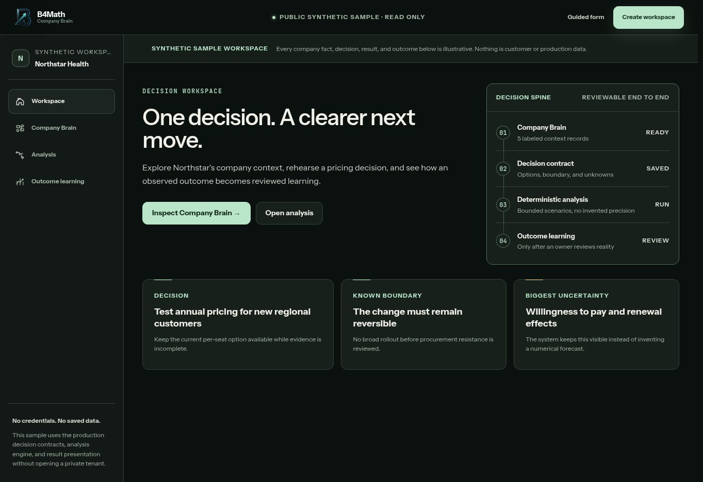
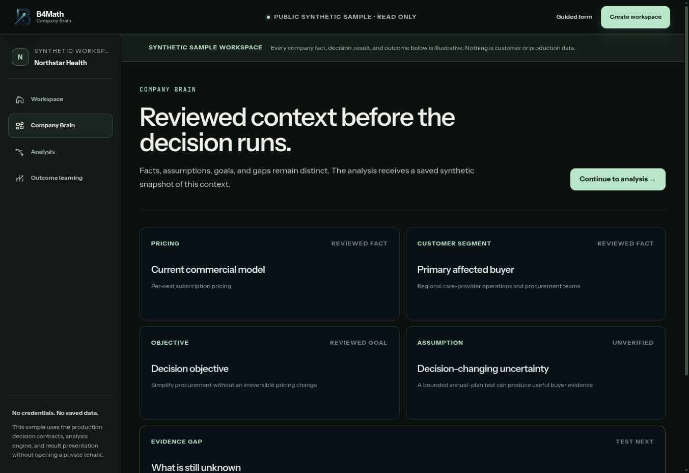
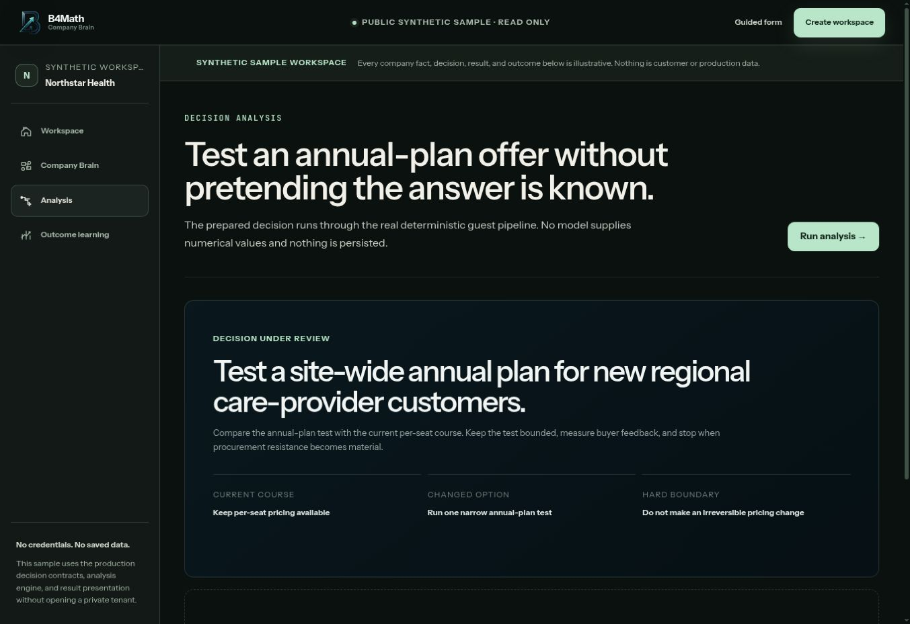
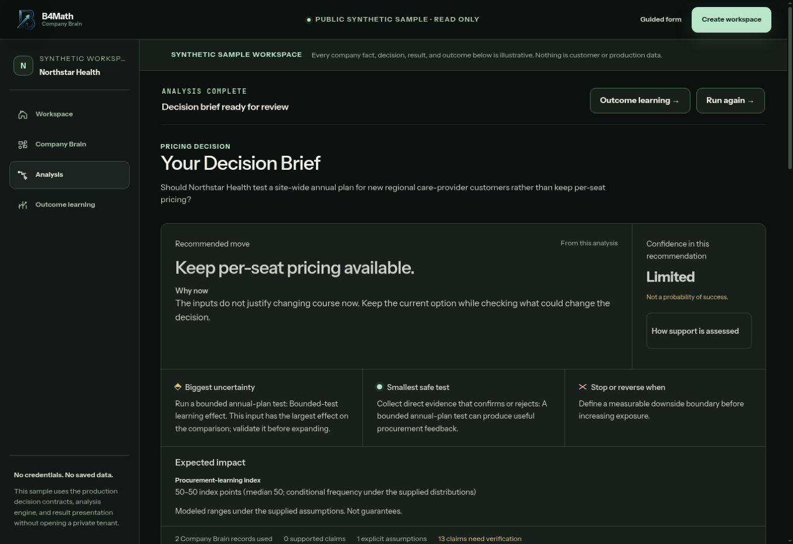
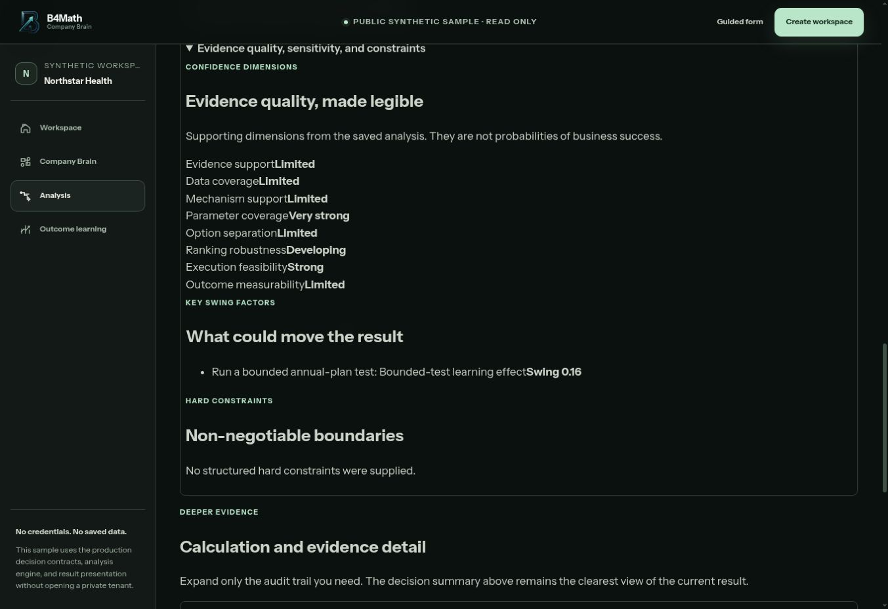
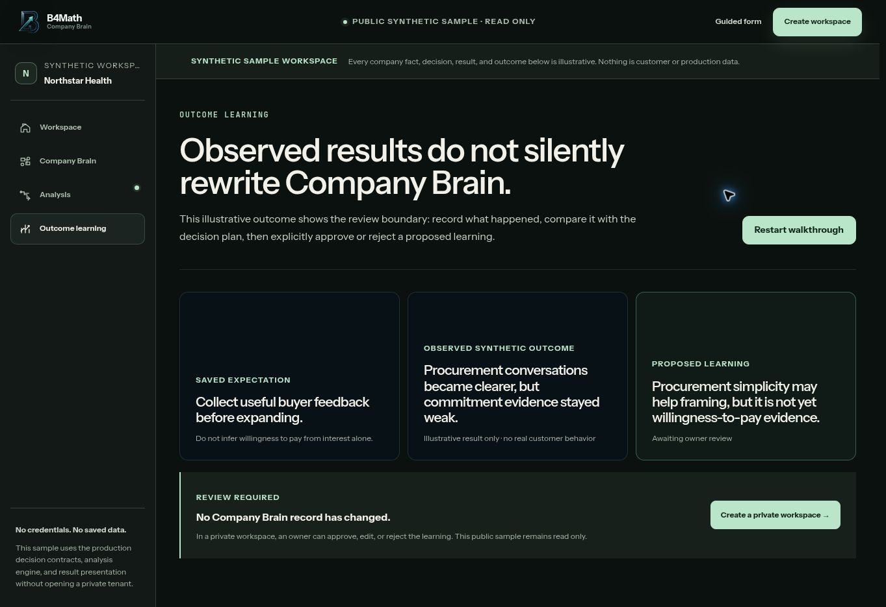

# B4Math product walkthrough

Six direct screenshots from the working public application on **November 7, 2026**. The Northstar Health example, decision, observations and numerical outputs are synthetic. The analysis result was executed in the public sample before capture.

[My backend and algorithm work](MY_BACKEND_AND_ALGORITHM_WORK.md) · [Overview](../README.md) · [Capture timestamps and image hashes](../assets/live-screenshots/2026-11-07/CAPTURE_INFO.json)

## Workspace

Open the public sample. The prepared decision is shown alongside company context, a reversible boundary and an unresolved willingness to pay question. This entry point makes the decision lifecycle visible.

## Company Brain

Select Company Brain. Reviewed facts and goals, an unverified assumption and an evidence gap have separate labels. My backend work concerns the versioned records and evidence relationships behind this distinction.

## Analysis setup

Select Analysis. The saved decision compares the current per seat course with a bounded annual plan test. The public page states that it runs the deterministic guest pipeline without persisting the sample.

## Decision result

Select Run analysis and wait for the Decision Brief. This capture follows a completed run. The recommendation retains the existing pricing option and reports limited support. The numerical outputs belong to the supplied synthetic assumptions.

## Evidence quality

From the result, select Evidence. The expanded section separates evidence support, data coverage, mechanism support, parameter coverage, option separation, ranking robustness, execution feasibility and outcome measurability. These are distinct support dimensions, not probabilities of success.

## Outcome learning

Select Outcome learning. A saved expectation, illustrative observation and proposed learning are shown separately. The owner review boundary is explicit: no Company Brain record has changed. The public sample demonstrates the boundary without saving a real update.

## Capture notes

The screenshots retain the browser capture bytes. No interface elements, values or content were reconstructed. Each image's metadata records its exact URL, time, viewport and SHA256 hash. Some B4Math sections share a URL because navigation changes the active view inside the same sample workspace.
